# Brixly Beer Game: คู่มือสำหรับมือใหม่

เว็บเกม: https://brixly-beer-game.vercel.app

## 1. เกมนี้คืออะไร

เกมจำลองการสั่งเบียร์ในห่วงโซ่อุปทาน นักศึกษาแต่ละคนเป็นหนึ่งในสี่ตำแหน่ง เรียงจากร้านค้าไปถึงต้นทาง

| ตำแหน่ง | ทำหน้าที่ |
|---|---|
| ร้านค้าปลีก (Retailer) | ขายให้ลูกค้า สั่งของจากตำแหน่งถัดไป |
| ผู้จัดจำหน่าย (Distributor) | สั่งของจากตำแหน่งถัดไป |
| โรงงานผู้ผลิต (Manufacturer) | สั่งของจากตำแหน่งถัดไป |
| ซัพพลายเออร์ (Supplier) | ตำแหน่งต้นทาง |

ทุกคนทำอย่างเดียวกัน คือ **ทุกสัปดาห์ตัดสินใจว่าจะสั่งของกี่หน่วย** แต่ของที่สั่งจะมาถึงช้า (ราว 2 สัปดาห์) และไม่เห็นตัวเลขของเพื่อนร่วมทีม

**จุดประสงค์:** ให้ทุกคนลองเองว่า ต่อให้ลูกค้าต้องการของเปลี่ยนไปนิดเดียว คนที่อยู่ต้นทางจะเจอความผันผวนใหญ่กว่ามาก เรียกว่า **Bullwhip Effect** (เหมือนปลายแส้ที่สะบัดแรงกว่าด้ามจับ)

## 2. กติกาที่นักศึกษาต้องรู้

- ของที่สั่งจะมาถึงใน **ราว 2 สัปดาห์**
- ของเหลือในโกดัง เสียค่าเก็บ **1 บาท** ต่อหน่วยต่อสัปดาห์
- ของค้างส่ง เสียค่าปรับ **2 บาท** ต่อหน่วยต่อสัปดาห์
- ส่งของออกไปไม่ได้เงินเพิ่ม **ยิ่งต้นทุนรวมน้อยยิ่งดี**
- รอบ 1 **ห้ามบอกตัวเลขให้เพื่อนในทีม**
- ไม่มีใครรู้ว่าเกมจบสัปดาห์ไหน (เพื่อไม่ให้หยุดสั่งตอนท้าย)

## 3. ภาพรวมของคาบ

เล่น 3 รอบ รอบละ 12 สัปดาห์

- **รอบ 1:** เล่นแยกกัน ไม่คุยกัน
- **รอบ 2:** ความต้องการลูกค้าชุดเดียวกับรอบ 1 แต่เปิด Breakout Room ให้คุยกันในทีม
- **รอบ 3:** อาจารย์ประกาศ "ข่าวด่วน" ราวสัปดาห์ที่ 4 (เช่น ลูกค้าต้องการเพิ่มขึ้นกะทันหัน) ทีมมีเวลาวางแผน 5–7 นาที

จบแล้วดูกราฟและอันดับของทุกทีมด้วยกัน

## 4. สำหรับอาจารย์: ทำตามทีละขั้น

### ก่อนวันสอน
1. กด **ทดลองเล่นคนเดียว** ที่หน้าแรก ซ้อมให้ครบ 3 รอบ
2. ลองกับเพื่อน 8–10 คนหนึ่งรอบ
3. ถ้าเว็บไม่ได้ใช้เกิน 7 วัน เข้า Supabase (supabase.com) แล้วกด **Restore** ก่อน

### ขั้นที่ 1: สร้างห้อง

เปิดเว็บ กดปุ่ม **สร้างห้องเรียน** (ปุ่มกลาง) จะได้หน้าจออาจารย์พร้อมรหัสห้อง 4 หลัก

<figure>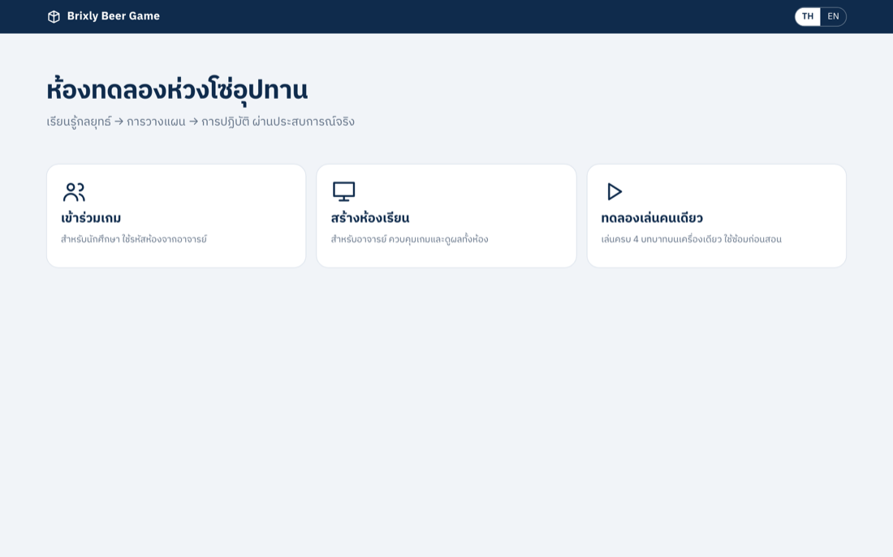<figcaption>หน้าแรก: เข้าร่วมเกม (นักศึกษา) / สร้างห้องเรียน (อาจารย์) / ทดลองเล่นคนเดียว</figcaption></figure>

<figure>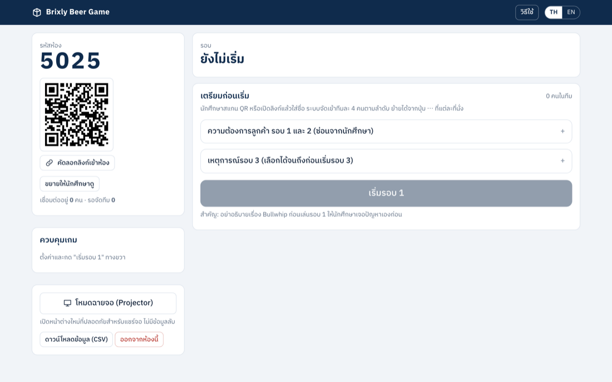<figcaption>หน้าจออาจารย์หลังสร้างห้อง: ซ้ายคือรหัสห้องและ QR ขวาคือปุ่มเริ่มเกม</figcaption></figure>

### ขั้นที่ 2: ให้นักศึกษาเข้าห้อง

- กด **คัดลอกลิงก์เข้าห้อง** แล้ววางในแชท Zoom/Meet/Teams
- หรือกด **ขยายให้นักศึกษาดู** เพื่อฉายรหัสห้องกับ QR ให้สแกน

<figure>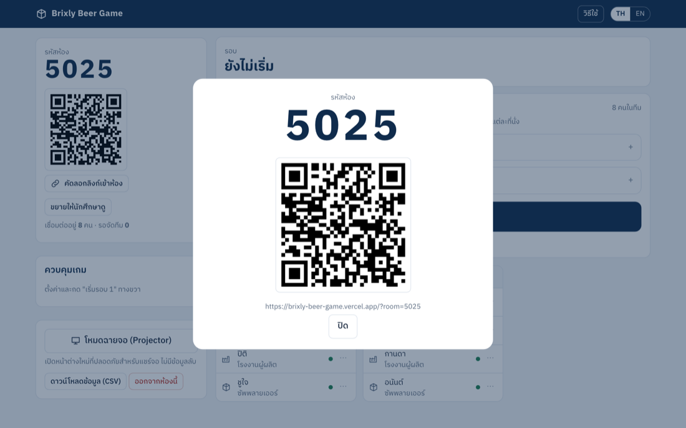<figcaption>หน้าต่างรหัสห้องและ QR (ปุ่ม "ขยายให้นักศึกษาดู")</figcaption></figure>

นักศึกษากดลิงก์ ใส่ชื่อ แล้วกด **เข้าห้อง** ระบบจัดที่นั่งให้เอง ทีมละ 4 คนตามลำดับที่เข้ามา (92 คน = 23 ทีม)

<table class="phones"><tr>
<td>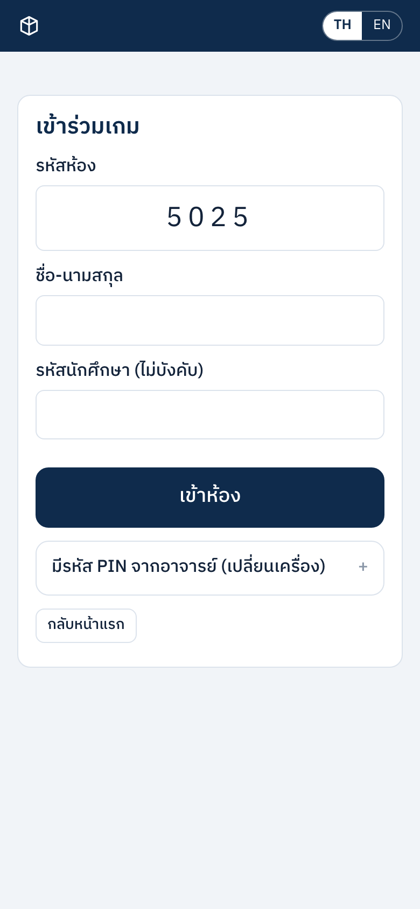 <small>นักศึกษากรอกชื่อ (รหัสห้องมาจากลิงก์)</small></td>
<td>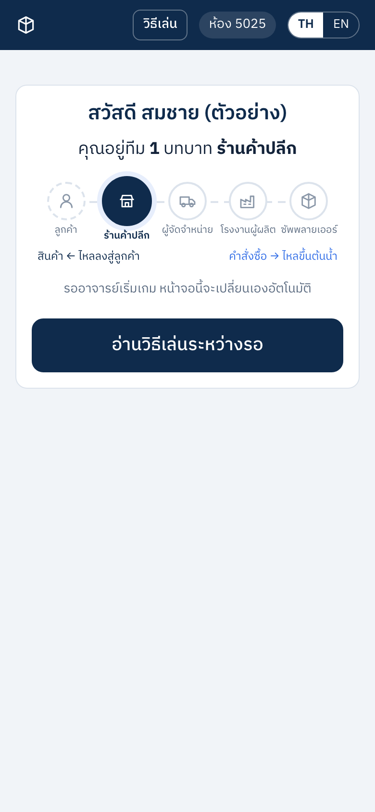 <small>ระบบบอกทีมและตำแหน่ง แล้วรออาจารย์เริ่ม</small></td>
</tr></table>

อาจารย์เห็นรายชื่อแยกตามทีมทันที ถ้าต้องการให้เพื่อนอยู่ทีมเดียวกัน ให้กดปุ่ม **⋯** ที่ชื่อแล้วย้ายที่นั่งก่อนเริ่ม

<figure>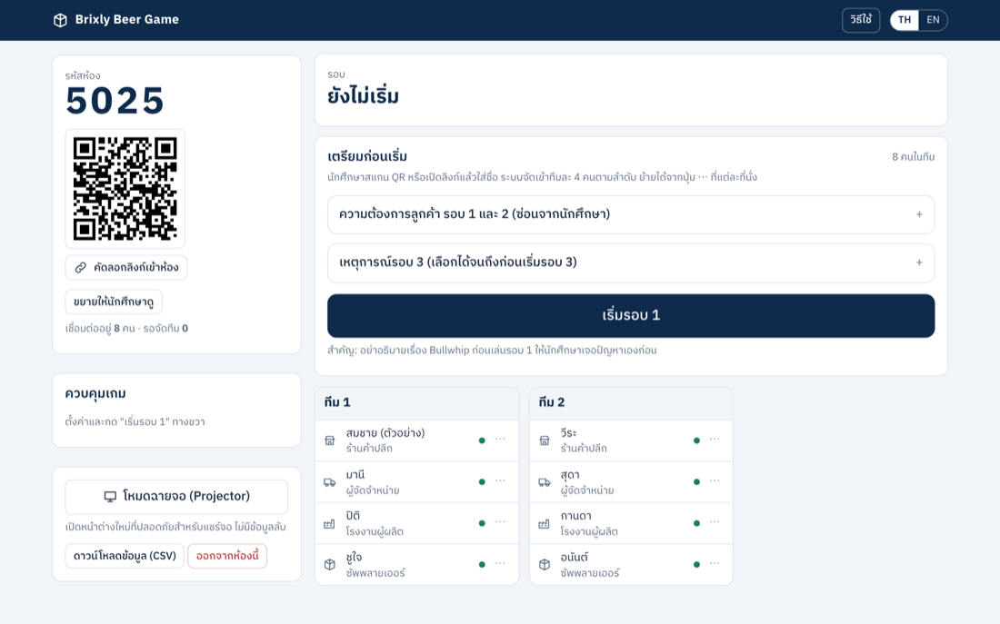<figcaption>8 คนเข้าห้อง ระบบจัดเป็น 2 ทีม ทีมละ 4 ตำแหน่ง</figcaption></figure>

### ขั้นที่ 3: เตรียมก่อนเริ่มรอบ 1

- เปิดหัวข้อ **ความต้องการลูกค้า รอบ 1 และ 2** และ **เหตุการณ์รอบ 3** เพื่อแก้ได้ก่อนเริ่ม (หลังเริ่มรอบ 1 แล้วแก้ไม่ได้) แนะนำ "พุ่งแรงแล้วค่อยลด" สำหรับรอบ 3
- เปิดจอฉาย: กด **โหมดฉายจอ (Projector)** จะเปิดหน้าต่างใหม่ที่ไม่มีข้อมูลลับ ให้แชร์เฉพาะหน้าต่างนั้น **ห้ามแชร์หน้าจออาจารย์**
- แจ้งกติกาในข้อ 2 แต่ **อย่าอธิบาย Bullwhip Effect** ก่อนรอบ 1

<figure>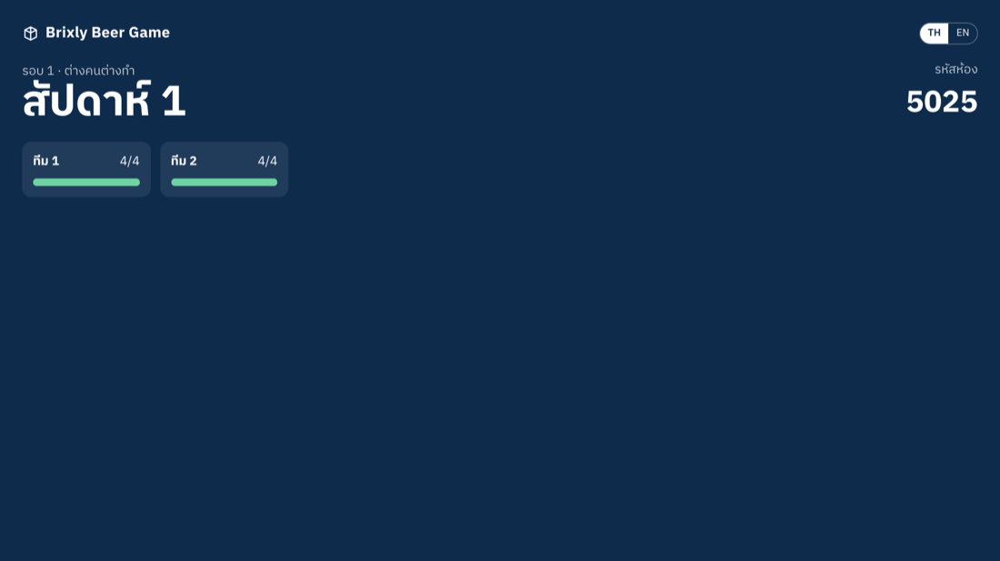<figcaption>หน้าจอฉาย: บอกสัปดาห์ รหัสห้อง และความคืบหน้าของแต่ละทีม โดยไม่มีตัวเลขลับ</figcaption></figure>

### ขั้นที่ 4: เล่นทีละสัปดาห์

1. กด **เริ่มรอบ 1**
2. นักศึกษาแต่ละคนส่งคำสั่งซื้อ (แนะนำให้เวลา 60 วินาทีต่อสัปดาห์)
3. อาจารย์ดูว่าใครส่งแล้ว (ช่อง "ส่งแล้ว 8 / 8" ด้านบน และเครื่องหมายถูกข้างชื่อ)
4. กด **สัปดาห์ถัดไป** ถ้ามีคนยังไม่ส่ง ระบบจะเตือน ให้เลือก **ไปต่อ** ระบบจะใช้คำสั่งซื้อเดิมของคนนั้นแทน
5. ทำซ้ำจนครบ 12 สัปดาห์

<figure>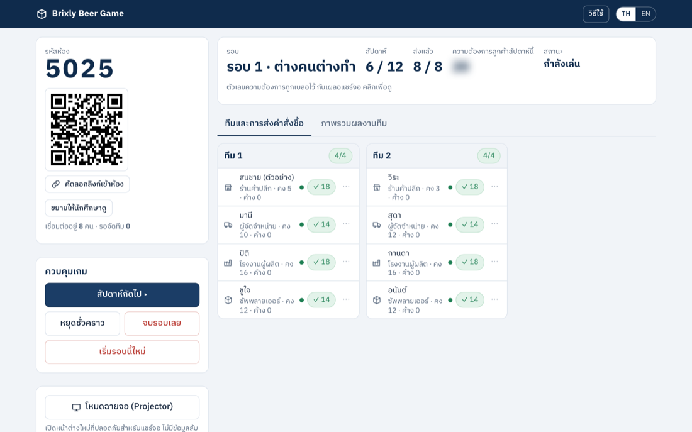<figcaption>สัปดาห์ที่ 6 จาก 12: ทุกคนส่งแล้ว (✓ ตัวเลขคือจำนวนที่สั่ง) กด "สัปดาห์ถัดไป" ได้เลย ปุ่มอื่น: หยุดชั่วคราว, จบรอบเลย, เริ่มรอบนี้ใหม่</figcaption></figure>

### เล่นพร้อมกัน 23 ทีม (92 คน) ในห้องเดียว

สร้างห้องเดียว ให้นักศึกษาทั้ง 92 คนเข้าห้องเดียวกัน ระบบจัดเป็น 23 ทีมทีมละ 4 คนให้เอง ทุกคนเล่นสัปดาห์เดียวกันพร้อมกัน อาจารย์กด **สัปดาห์ถัดไป** ครั้งเดียว ทุกทีมก็เดินหน้าไปพร้อมกัน และเห็นว่า "ส่งแล้ว" กี่คนจาก 92

<figure>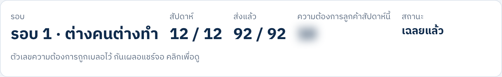<figcaption>ตัวอย่างจากการจำลอง: ครบ 12 สัปดาห์ ส่งแล้ว 92 / 92 คน (23 ทีม)</figcaption></figure>

### ขั้นที่ 5: จบรอบและสรุป

1. เมื่อครบ 12 สัปดาห์ ปุ่มจะเปลี่ยนเป็น **จบรอบและเฉลยผล** กดเพื่อเปิดเผยผล
2. เปิดแท็บ **ผลลัพธ์และสรุปบทเรียน** เริ่มจากกราฟ **ภาพรวมทั้งห้อง** แล้วเลือกเล่า 2–3 ทีมจากแท็บ **ภาพรวมผลงานทีม**
3. ค่อยอธิบาย Bullwhip Effect
4. กด **ดาวน์โหลดข้อมูล (CSV)** เก็บผลไว้
5. กด **เริ่มรอบ 2** และ **เริ่มรอบ 3** ต่อ (รอบ 2 และ 3 เปิด Breakout Room ทีมละห้อง)

<figure><figcaption>ครบ 12 สัปดาห์: กด "จบรอบและเฉลยผล"</figcaption></figure>

<figure>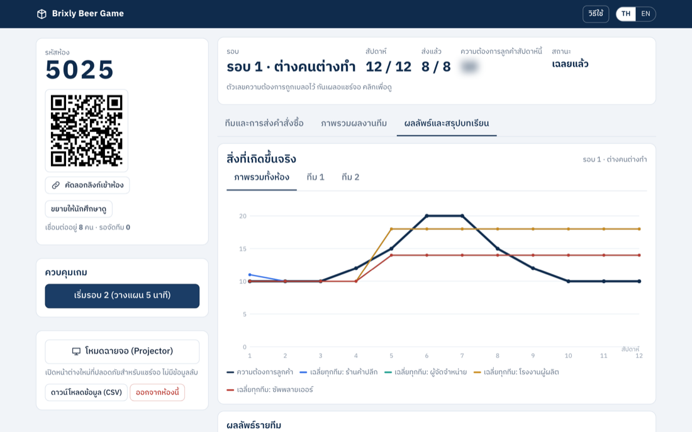<figcaption>กราฟภาพรวมทั้งห้อง: เส้นหนาคือความต้องการลูกค้า เส้นสีคือคำสั่งซื้อเฉลี่ยของแต่ละตำแหน่ง ยิ่งต้นน้ำ ยิ่งแกว่งไกลจากลูกค้า</figcaption></figure>

### ดูคะแนนของแต่ละทีม (ระบบคำนวณให้เอง)

หลังกด **จบรอบและเฉลยผล** (หรือระหว่างเล่นก็ดูได้) เปิดแท็บ **ภาพรวมผลงานทีม** จะเห็นตารางเรียงอันดับของทุกทีม พร้อมคะแนนรวมเต็ม 100 ที่ระบบคำนวณเอง ไม่ต้องคิดเอง

คะแนนรวมมาจากการเทียบระหว่างทีม ดังนี้

- ต้นทุนรวม (ยิ่งน้อยยิ่งดี) 35%
- ระดับบริการ (ส่งของทันลูกค้ากี่เปอร์เซ็นต์) 35%
- ของค้างส่งสูงสุด (ยิ่งน้อยยิ่งดี) 15%
- Bullwhip (ความแกว่งของคำสั่งซื้อ ยิ่งน้อยยิ่งดี) 15%

สูตรนี้ป้องกันไม่ให้ทีมเล่นเอาแต่ตัวชี้วัดเดียว (เช่น ไม่สั่งเลยเพื่อลดต้นทุน)

<figure>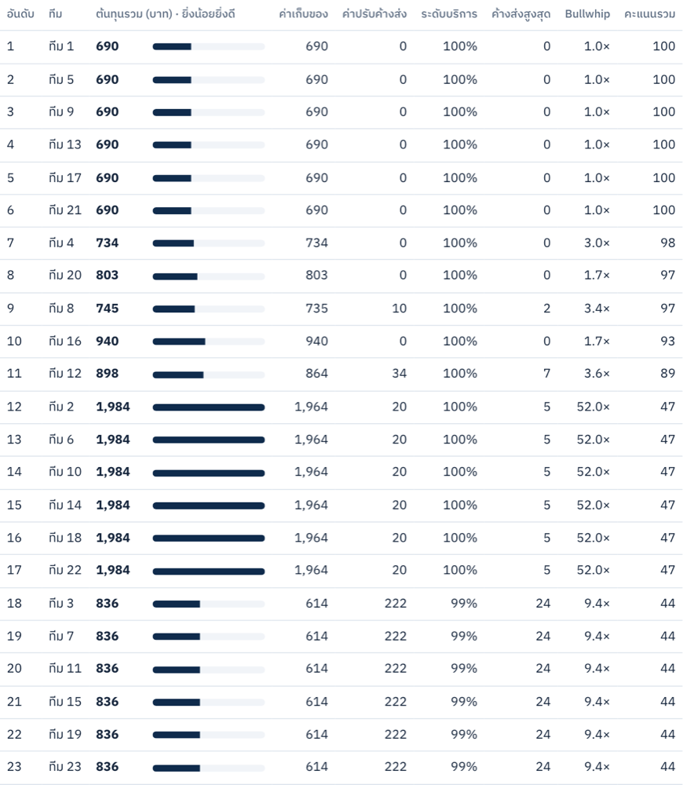<figcaption>ตัวอย่างตารางคะแนน 23 ทีม (ข้อมูลจากการจำลอง): อันดับ, ต้นทุนรวม, ค่าเก็บของ, ค่าปรับค้างส่ง, ระดับบริการ, ค้างส่งสูงสุด, Bullwhip และคะแนนรวมท้ายสุด</figcaption></figure>

ด้านบนของแท็บนี้ยังมีสรุปว่าทีมไหนอันดับ 1 ต้นทุนต่ำสุด และบริการดีที่สุด และด้านล่างมีกราฟแยกรายทีม เลือกเล่า 2–3 ทีมที่น่าสนใจได้

### ขั้นที่ 6: รอบ 3 ประกาศข่าวด่วน

ราวสัปดาห์ที่ 4 ของรอบ 3 กดปุ่มสีฟ้า **ประกาศข่าวด่วน (Shock)** ระบบจะหยุดเกมและเริ่มนับถอยหลังเวลาตัดสินใจ 6 นาที ให้ทีมคิดกลยุทธ์ วางแผน และปฏิบัติ

<figure>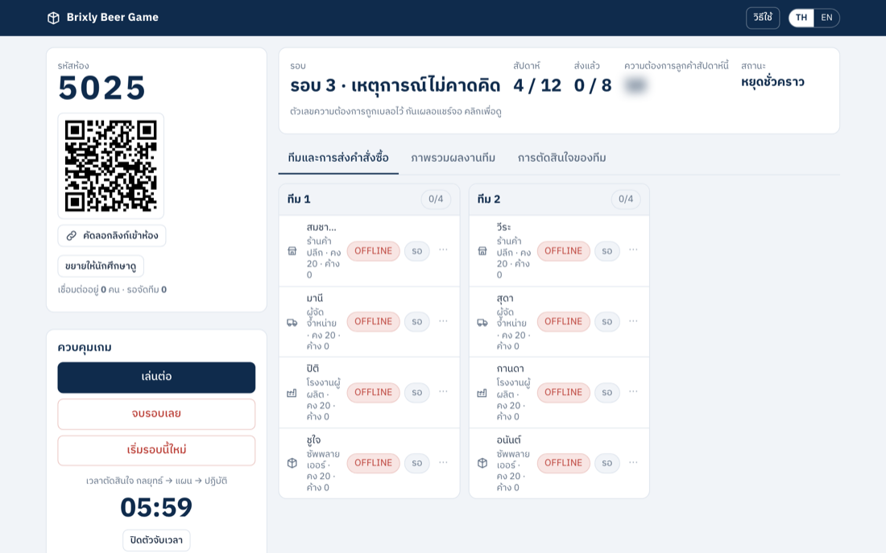<figcaption>หลังประกาศข่าวด่วน: สถานะ "หยุดชั่วคราว" และตัวจับเวลา เมื่อพร้อมกด "เล่นต่อ" (ในภาพทุกคนขึ้น OFFLINE เพราะเป็นห้องทดสอบที่ไม่มีนักศึกษาเปิดหน้าเว็บอยู่)</figcaption></figure>

## 5. สำหรับนักศึกษา

1. กดลิงก์ที่อาจารย์ส่ง ใส่ชื่อ กด **เข้าห้อง**
2. ดูว่าได้ทีมและตำแหน่งอะไร รออาจารย์เริ่ม
3. ทุกสัปดาห์ดู 4 ช่อง: **สินค้าคงคลัง**, **คำสั่งซื้อจากลูกค้า**, **สินค้าค้างส่ง**, **รับสินค้าเข้าสัปดาห์นี้** และ **ต้นทุนสะสม** (ยิ่งน้อยยิ่งดี)
4. เลื่อนลง พิมพ์จำนวนที่จะสั่ง (หรือกด − / +) กด **ส่งคำสั่งซื้อ** แล้วกด **ยืนยันส่ง** อีกครั้ง
5. รอเพื่อนส่งครบ อาจารย์จะพาไปสัปดาห์ต่อไป

<table class="phones"><tr>
<td>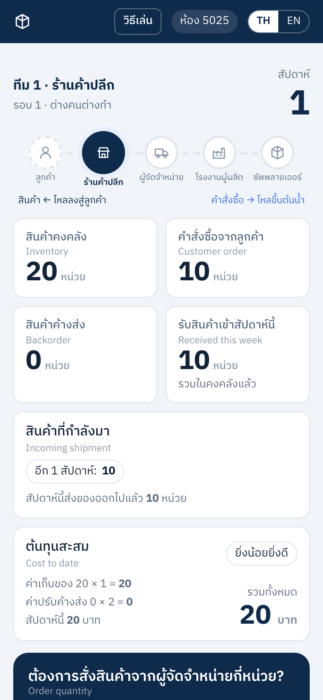 <small>หน้าหลัก: ตัวเลขของสัปดาห์นี้</small></td>
<td>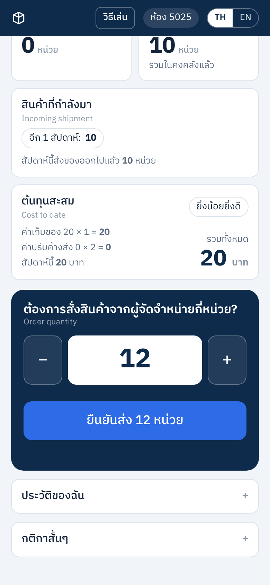 <small>พิมพ์จำนวน แล้วกด "ยืนยันส่ง"</small></td>
<td>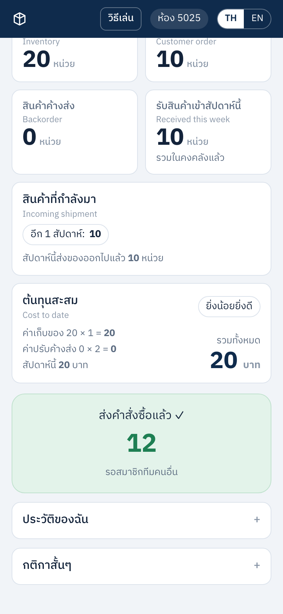 <small>ส่งแล้ว ✓ รอเพื่อนในทีม</small></td>
</tr></table>

**ถ้าหลุดจากเกม:** เปิดลิงก์เดิมอีกครั้ง จะกลับที่นั่งเดิม

## 6. แก้ปัญหาเฉพาะหน้า

กดปุ่ม **⋯** ที่ชื่อนักศึกษาในหน้าจออาจารย์

<figure>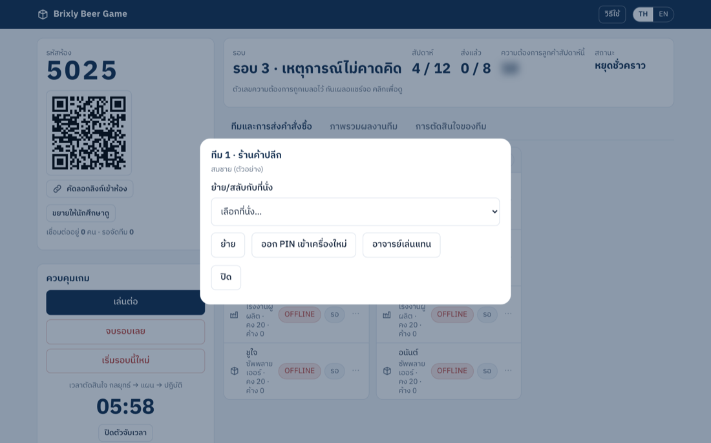<figcaption>เมนูที่นั่ง: ย้าย/สลับที่นั่ง, ออก PIN เข้าเครื่องใหม่, อาจารย์เล่นแทน</figcaption></figure>

| ปัญหา | วิธีแก้ |
|---|---|
| นักศึกษาเปลี่ยนเครื่อง | **ออก PIN เข้าเครื่องใหม่** แล้วให้นักศึกษากด "มีรหัส PIN จากอาจารย์" ที่หน้าเข้าห้อง |
| นักศึกษาออกกลางคาบ | **อาจารย์เล่นแทน** หรือย้ายคนที่มาสายเข้าแทน |
| พิมพ์ตัวเลขผิดหลังส่งแล้ว | กด **อนุญาตให้แก้คำสั่งซื้อ** (แก้ได้ 1 ครั้ง) |
| ทีมมีคนไม่ครบ 4 | ที่นั่งว่างระบบสั่งซื้อแทนอัตโนมัติ หรือย้ายนักศึกษามาเติมก่อนเริ่มรอบ |
| อยากเริ่มรอบใหม่ | กด **เริ่มรอบนี้ใหม่** (ข้อมูลเดิมยังอยู่ในไฟล์ CSV) |

## 7. คำศัพท์สั้นๆ

- **Bullwhip Effect:** ความผันผวนของคำสั่งซื้อที่ขยายใหญ่ขึ้นเรื่อยๆ ยิ่งไกลจากลูกค้า
- **สินค้าค้างส่ง (Backorder):** ลูกค้าสั่งแล้วแต่ของไม่พอส่ง
- **สินค้าคงคลัง (Inventory):** ของที่เหลืออยู่ในโกดัง
- **Lead time:** เวลาที่ของใช้เดินทางมาถึง
- **Breakout Room:** ห้องย่อยใน Zoom ให้แต่ละทีมคุยกัน

## 8. ตั้งค่าระบบ (ทำครั้งเดียว สำหรับผู้ดูแล)

1. เกมนี้ประกอบด้วยหน้าเว็บ (`index.html`) และฐานข้อมูล Supabase (`supabase_setup.sql`) ที่เก็บข้อมูลกลาง
2. สร้างโปรเจกต์ที่ supabase.com (เลือก Singapore) แล้วรัน `supabase_setup.sql` ใน SQL Editor
3. คัดลอก Project URL และ anon key ไปใส่ใน `index.html` (บรรทัด `SUPABASE_URL` และ `SUPABASE_ANON_KEY`)
4. อัปโหลดโค้ดขึ้น GitHub แล้วเชื่อมกับ Vercel (vercel.com/new เลือก Other แล้วกด Deploy)
5. ต่อไปทุกครั้งที่ push เข้า branch `main` เว็บจะอัปเดตเอง

รายละเอียดเพิ่ม: ดู `SETUP-TH.md`
